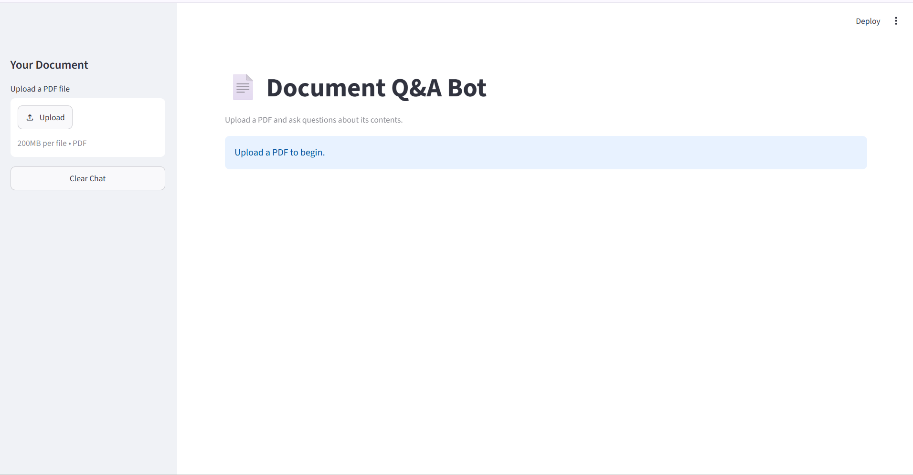
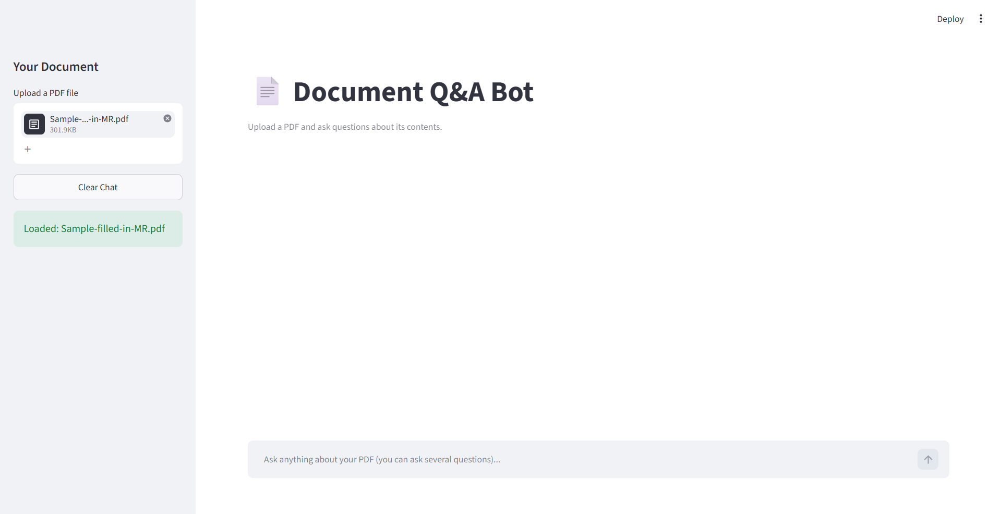
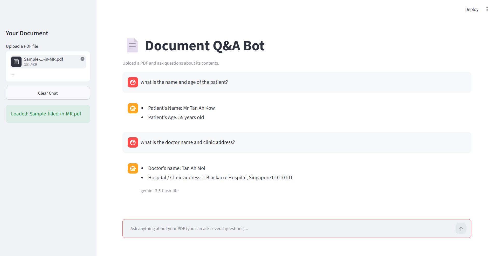

# 📄 Document Q&A Bot

An AI-powered application that lets users upload PDF documents and ask questions about their content through an interactive chat interface.

Built using Python, Streamlit, LangChain, and Google Gemini AI, this project explores how Generative AI and semantic search can simplify information retrieval from lengthy documents.

## 💡 Why I Built This Project

Have you ever spent several minutes searching through a lengthy PDF to find one specific piece of information?

I built this project to explore how AI can simplify that process by allowing users to ask questions directly and receive answers based on relevant document content.

This project helped me apply my Python skills, explore Large Language Models (LLMs), and gain practical experience building an AI-powered application.

## ✨ Features

- 📤 Upload PDF documents.
- 💬 Ask questions through an interactive chat interface.
- 🔍 Retrieve relevant information from document content.
- 🤖 Generate AI-powered answers using Google Gemini.
- 📚 Split extracted document text into manageable chunks.
- 🧠 Use text embeddings for semantic document retrieval.
- 🖥️ Interact with the application through a Streamlit interface.

*Note: Available features depend on the current implementation and API availability.*

## 📸 Screenshots

### Home Page



### Document Uploaded



### Chat Answer



## 🛠️ Tech Stack

- **Python** — Core programming language
- **Streamlit** — Interactive web interface
- **LangChain** — Document processing and language model integration
- **Google Gemini AI** — AI-powered answer generation
- **Google Gemini Embeddings** — Text vectorization for semantic search
- **Vector Store** — Storage and retrieval of document embeddings
- **PyPDF** — PDF text extraction through the configured document loader

## ⚙️ How It Works

1. **Upload a PDF:** The user uploads a document through the interface.
2. **Extract Text:** The application extracts text from the PDF.
3. **Split into Chunks:** The text is divided into smaller, manageable sections.
4. **Generate Embeddings:** Text chunks are converted into vector representations.
5. **Retrieve Relevant Content:** The vector store finds document sections relevant to the user's question.
6. **Generate an Answer:** Google Gemini uses the retrieved context to generate a response.
7. **Display the Response:** The answer appears in the chat interface.

## 🚀 Getting Started

### Prerequisites

- Python 3.10 or a compatible version supported by your dependencies
- A Google Gemini API key
- Git (optional, for cloning the repository)

### 1. Clone the Repository

```bash
git clone https://github.com/sharmarewa96-tech/Document-QnA-Bot.git
cd Document-QnA-Bot
```

### 2. Create a Virtual Environment

**Windows:**

```powershell
python -m venv env
.\env\Scripts\Activate.ps1
```

### 3. Install Dependencies

```bash
pip install -r requirements.txt
```

### 4. Configure Environment Variables

Create a `.env` file in the project root directory and add your Gemini API key:

```env
GOOGLE_API_KEY=your_gemini_api_key_here
```

Replace the placeholder with your own API key. Never commit your `.env` file or publish your API key.

### 5. Run the Application

```bash
streamlit run app.py
```

The application will open in your browser.

## 🔐 API Key and Usage Notes

This application uses Google Gemini API services. Availability, response speed, and usage limits may depend on your API plan, quota, and model availability.

If you encounter quota errors, check your Google AI account's current usage limits.

## 📁 Project Structure

```text
Document-QnA-Bot/
├── screenshots/
│   ├── home.png
│   ├── document_uploaded.png
│   └── chat_answer.png
├── app.py
├── requirements.txt
├── README.md
└── .gitignore
```

The virtual environment and `.env` file are intentionally excluded from the repository.

## 🎯 Learning Outcomes

Through this project, I explored:

- Building interactive applications with Streamlit
- Integrating Large Language Models into Python applications
- Processing PDF documents and splitting text into chunks
- Understanding text embeddings and semantic search
- Retrieving relevant context for AI-generated answers
- Managing environment variables and API credentials
- Handling API errors and improving application usability

## 🔮 Future Improvements

- Support for multiple PDF documents
- Better error handling and API quota management
- Improved response time and document-processing performance
- More informative loading indicators
- Enhanced chat history and user experience

## 👩‍💻 Author

**Rewa Sharma**

Aspiring Software Developer | Exploring AI/ML and Generative AI

- GitHub: [sharmarewa96-tech](https://github.com/sharmarewa96-tech)

---

*Built as a learning project to explore practical applications of Generative AI.*
